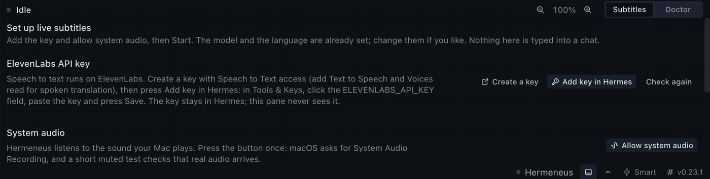
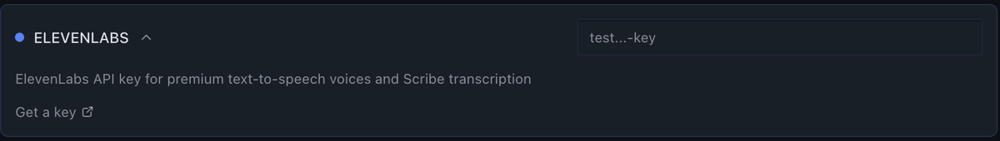

# Hermeneus

Live translation for Hermes.

In Greek myth, Hermes is the messenger of the gods. The Greek word *hermeneus* means interpreter, a person who carries speech from one language into another. English *hermeneutics*, the study of interpretation, comes from the same word family. The Greeks linked the word to Hermes; modern dictionaries treat its origin as uncertain. Hermes Agent carries the messenger's name. Hermeneus is the interpreter that works beside it: it listens to any voice playing on your computer and gives it to you in your own language, as subtitles or as speech.

<!-- CAPTURE-PENDING: docs/media/strip-live.gif, the floating subtitle strip over a live news stream, recorded from this build with the owner. -->


<!-- CAPTURE-PENDING: docs/media/pane.png, the Hermeneus pane in Hermes Desktop during a session. -->


## What it does

- Hermeneus captures the audio of one app, or of all system audio, on your Mac.
- ElevenLabs Scribe v3 Live turns the speech into text as it is spoken.
- The model you already use in Hermes translates each finished sentence.
- The translation appears as a subtitle in a floating strip, in a Hermes Desktop pane, on a local page for OBS and in your terminal.
- Spoken translation is optional. When you turn it on, ElevenLabs Flash v2.5 reads each translated line aloud on an output device you choose.

This release is tested on macOS with real audio. Windows support is a preview: it is implemented and reviewed against documentation, and has not yet run on a Windows machine (see [Windows (preview)](#windows-preview)). Linux support is planned.

## Quick start

You need:

- macOS 14.2 or later. macOS 13 works only with the [virtual device fallback](#fallback-virtual-device-with-a-multi-output-device).
- Hermes 0.23.1 or later with a model set up, and Hermes Desktop for the clicks below.
- An ElevenLabs account. Hermeneus uses your own key and your own billing (see [Cost](#cost)).

### In Hermes Desktop

1. **Install.** Open **Capabilities > Plugins** and press **Install from Git**. Enter `https://github.com/Bihruze/hermeneus`, press **Review repository**, then **Install**. Hermes installs the Python libraries Hermeneus needs and turns on the plugin, its pane and its status bar item. The pane opens by itself on **Set up live subtitles**. Once the catalog lists Hermeneus, the **Install** button on its card does the same without the address.

   

2. **Restart the gateway once.** Hermes puts the new libraries in a fresh environment that the running gateway cannot load yet, so the pane's **System audio** step says the audio libraries are not loaded. Click **Backend** in Hermes's status bar at the bottom of the window, then the power button in its menu (its tooltip says **Restart gateway**). Quitting and reopening Hermes Desktop may not be enough, because a gateway running in the background survives it. When the gateway is back, the pane reads the setup again by itself.
3. **Add your ElevenLabs key.** Press **Create a key**. Your browser opens ElevenLabs. Give the key Speech to Text access, and also Text to Speech and Voices read if you want spoken translation. Back in the pane, press **Add key in Hermes**. Hermes opens **Settings > Tools & Keys**. Click the `ELEVENLABS_API_KEY` field, paste the key and press **Save**. Hermes shows "Credential saved", and within a few seconds the pane shows the key step as **Done**. The key goes into Hermes's own key store, never into a chat or into the pane.

   

4. **Allow system audio.** In the pane, press **Allow system audio**. macOS asks for the System Audio Recording permission for Hermes. Click **Allow**. Hermeneus then runs a short test capture with a quiet test tone and shows **Done** when real audio arrives. If you clicked **Don't Allow**, press **Open System Settings**, turn on Hermes under **System Audio Recording Only**, and press **Check again**.
5. **Start.** The translation model is your main Hermes model. The subtitle language is your Hermes or system language. Both are filled in. Press **Start**. Subtitles appear in the pane and in the floating strip above your other apps.

If the pane is closed, click **Hermeneus** in the status bar. Until setup is complete, that click opens the pane instead of starting. After the first run, one click on **Hermeneus** starts or stops translation with your last settings. The arrow next to it opens the source, language, mode, voice and overlay controls.

For subtitles closer to the speech, press **Choose a faster model** in the pane. It opens **Settings > Models** at **Live translation** (see [Translation model](#translation-model)).

### In a terminal

```bash
hermes plugins install Bihruze/hermeneus   # enter the key at its masked ELEVENLABS_API_KEY prompt; answer y to enable it and to install its Python packages
hermes hermeneus doctor                    # the first run shows the macOS System Audio Recording prompt
hermes hermeneus run --to tr               # live subtitles in this terminal
```

The key is typed only at Hermes's masked prompt, so it never appears on a command line or in your shell history. To add or change it later, use **Settings > Tools & Keys** in Hermes Desktop.

After a terminal install, Hermes Desktop keeps the pane and the status bar item switched off. Hermes turns on the desktop half of a plugin package only when Desktop's own install dialog installs it. To turn them on, open **Capabilities > Plugins**, press **Rescan** if the Hermeneus row says "copying...", and turn on its **Desktop** switch. If Hermes Desktop was running while you installed, restart its gateway once (step 2 above) before the pane's audio step.

Other install sources:

```bash
hermes plugins install hermeneus                 # from the Hermes plugin catalog, once it is listed
git clone https://github.com/Bihruze/hermeneus.git
hermes plugins install file://$PWD/hermeneus     # from a local clone; Hermes prints a security warning for file:// sources
hermes plugins enable hermeneus                  # if Hermes installed it disabled
hermes plugins remove hermeneus                  # remove it
```

The Python packages (`websockets`, `sounddevice`, `numpy`, on macOS `pyobjc-framework-CoreAudio` and `pyobjc-framework-Cocoa`, on Windows only `comtypes`, `pycaw` and `psutil`) are declared in `pyproject.toml`. Hermes asks before it installs them. They need Python 3.12 or later: Hermes itself allows 3.11, but numpy 2.5.4 (the version Hermes v0.23.1 pins in its `voice` extra) declares `Requires-Python >=3.12`.

### The System Audio Recording permission

macOS asks for this permission the first time Hermeneus captures audio through a process tap: in the setup, in the doctor's check or in your first session. The prompt names the app that runs Hermes: Hermes for Desktop, or your terminal app (for example Terminal or iTerm) for the CLI.

1. Click **Allow** when macOS shows the prompt.
2. If you clicked **Don't Allow** or no prompt appeared, open **System Settings > Privacy & Security > Screen & System Audio Recording**. Under **System Audio Recording Only**, turn on the app that runs Hermes. The full Screen & System Audio Recording entry also works, but Hermeneus needs only the audio part.
3. Quit and reopen that app, then run the check again.

Without the permission macOS delivers silence instead of audio. The setup, the doctor and a running session all report that, with the fix above. A session waits up to 30 seconds for capture to start while the prompt is open.

Apps cannot read this permission directly: macOS keeps it in a database that apps can read only by asking for it or with Full Disk Access. The setup and the doctor therefore prove it with a test capture (see [The permission it asks for](#the-permission-it-asks-for)).

## Where subtitles appear

Every place that shows the session shows the same lines. Every way of starting a session needs a target language: the setup fills it in, `--to` passes it, or the `target_language` setting holds it.

### Floating strip

The strip floats near the bottom of the screen, above every other app, including a full-screen video. It never takes keyboard focus, and clicks pass through it to the app underneath.

- **When it opens.** The strip opens with every session started on this Mac (setting `overlay`, on by default). The overlay button in the pane's controls row or next to the status bar item shows or hides it. While no session runs, those buttons arm it for the next session. `hermes hermeneus overlay show|hide|status` and `/translate overlay show|hide|status` do the same. It closes by itself when the session stops.
- **What it shows.** It shows the translation only, in large text. A sentence appears when its translation is ready. While speech is still being translated, a small dot in a faint ring shows in its own spot at the strip's right end, and the words in the source language never show. Turn on `overlay_show_original` to also see the heard sentence in small text above its translation.
- **Rows.** Text rolls up: new text enters at the bottom and older rows move up and out, at a pace you can read (see [Subtitle pace](#subtitle-pace)). Each speaker turn starts a row of its own. A small number in the speaker's colour marks the first row of a turn (`overlay_show_speaker`). The strip clears 7 seconds after the last text went up, once nothing waits.
- **Moving it.** Drag the grip at the left edge to move the strip. Right-click the grip for width presets, **Reset position** and **Hide overlay**. Double-click it for the default width, with the rows back to `overlay_max_lines`.
- **Resizing it.** Drag the handle at the right edge for the width, the short bar at the top edge for the height, or the corner square at the top right for both. The bottom edge stays put, so the strip grows upward. The height snaps to whole rows when you let go, from 1 to 6, so a row is never cut. The width goes from 320 pt to the whole width of the screen. Position, width and rows are remembered for each display, and the pane saves new rows as `overlay_max_lines`.
- **Reading back.** Click the small up arrow above the strip's right end, or scroll over it. The strip grows to 6 rows of history and a **Back to live** tab appears. While history is open, the strip takes the mouse: scroll to move through earlier rows, click it or **Back to live** to return. It returns to live by itself after 8 seconds without a scroll. New text keeps arriving underneath, and nothing is lost.
- **Look.** The default style, `banner`, uses deep navy, a periwinkle edge and warm white text. The `theme` style follows your Hermes Desktop theme in its light or dark mode. The background is 90% opaque by default, so a news ticker in the video does not show through the letters. Below 50% opacity the text is always light with a thin dark outline. Every speaker colour is at least 4.5:1 (WCAG AA) against the strip.
- **Look menu.** The look button next to the pane's overlay button sets the style, text size, rows, background opacity, the original line, speaker numbers and the pace. A change there or in Settings reaches an open strip without closing it.

The strip opens only on the Mac where the request comes from. A slash command from a chat platform, or a Desktop connected to a remote backend, is refused with a message.

#### Subtitle pace

The strip and the overlay page show text through a display queue that follows professional subtitle practice. The queue changes when text is shown, not how fast it is produced.

| Rule | Value | Source |
| --- | --- | --- |
| Reading speed | Turkish 17, English 20, most other languages 17 characters per second; `overlay_reading_cps` overrides it (5 to 30) | Netflix Timed Text Style Guides (Turkish I.17; English I.14 and II.17) |
| Minimum time on screen | 1 s per unit | between Netflix (5/6 s) and DCMP (40 frames, 1.33 s at 30 fps); BBC 4.1 gives 1.2 s for 4 words |
| Unit | a sentence when it fits the strip's rows, otherwise even phrases cut after punctuation, before a conjunction or after a Turkish postposition, never inside a word. The limit is `min(84, max(16, 0.85 x rows x characters per row))` | Netflix 42 characters per line (Turkish I.8); Netflix and BBC 3.4 line-break rules |
| Rows | 2 by default (`overlay_max_lines`, 1 to 6, or drag the strip's top edge), rolling up | BBC live subtitles: two scrolling lines (21.5); CEA-608 roll-up: 2 to 4 rows (former 47 CFR 79.101(f)(1)) |
| Hold | the strip clears 7 s after the last unit went up, once no unit waits | Netflix: 7 s at most per subtitle |
| Mid-sentence | a top row that starts inside a sentence begins with "…" | Netflix Turkish I.5 |

Each unit stays its reading time before the next one enters, in the order the sentences were spoken. Rows already on screen never change. No text is dropped or shortened. A line whose translation is still on its way holds the lines after it for at most 6 s. After that the later lines go up first, so a line translated more than 6 s late can appear out of speech order.

When speech is faster than reading speed, `overlay_pace` decides:

- `read` (read everything, the default) gives every unit its full reading time. Subtitles may fall behind fast speech and catch up in pauses.
- `live` (follow live) shortens units while more than 3 s of reading waits, down to half their reading time and never under the minimum. Scroll back to read what went by.

Measured lag on real audio:

| Clip | Translation ready (p50 / p95 / max) | `read`: first part on screen p50; last part p50 / p95 / max | `live`: first part p50; last part p50 / p95 / max |
| --- | --- | --- | --- |
| Al Jazeera English news, 4.2 min, 155 wpm (14.1 characters per second in Turkish) | 2.03 / 3.29 / 4.42 s | 3.6 s; 6.7 / 9.0 / 10.7 s | 2.5 s; 3.8 / 5.3 / 7.3 s |
| Last Week Tonight (talk show), 3.7 min, 185 wpm (20.0 characters per second in Turkish) | 1.82 / 2.93 / 6.84 s | 21.5 s; 23.9 / 37.9 / 41.8 s | 3.0 s; 4.0 / 9.5 / 13.3 s |

How it was measured:

- An independent audit ran two real sessions with ElevenLabs Scribe v3 Live and translation into Turkish by `claude-haiku-5-5` (provider `anthropic`), with the audio taken from the player.
- Each session's time-stamped events were then replayed through the overlay code with an offscreen strip at the default settings, 860 pt wide.
- Every time runs from the end of a spoken sentence.

News at 14 characters per second stays below the Turkish reading speed, so both paces stay close to live. The talk show runs above it, so `read` falls behind for as long as the fast speech goes on, while `live` stays within 13.3 s. That maximum came on one 404-character line in which the model wrote notes around its translation. The translator now keeps only the corrected part of such a reply (see [Translation model](#translation-model)).

### Hermes Desktop pane

The pane sits at the bottom of the Desktop workspace, with a **Hermeneus** item on the right of the status bar. It has two tabs.

- **Subtitles.** The controls row holds **Source**, **Subtitle language** and **Mode** (Subtitles only, Subtitles and voice, Voice only). With a voice mode, the **Voice and output device** button opens the **Voice** and **Output device** pickers. The **Subtitle overlay** button opens or closes the strip. **Start** and **Stop** are at the end of the row. Each choice is saved, and a changed choice applies to a running session at once.
- **Lines.** Each line shows the translation, with the original under it in smaller, dimmer text, tagged with the language Scribe heard. Speakers are named Speaker 1, Speaker 2 and so on, each in its own colour. The list follows the newest line. Scroll up to read back; **Jump to live** and the number of new lines bring you back. Buttons change the subtitle size.
- **Doctor.** The same checks as `hermes hermeneus doctor`, with **Run checks again**. It runs the capture check with its test tone each time you open the tab or press the button.

Closing the pane with its close button turns the whole plugin off, status bar item included. Desktop treats every plugin with one pane this way. Turn it on again in **Capabilities > Plugins**; it comes back in the same place.

The pane talks to the Hermes gateway through the plugin's backend routes under `/api/plugins/hermeneus/` on Hermes's own server.

### Overlay page for OBS

```bash
hermes hermeneus overlay-page on                # serve the page during every session
hermes hermeneus overlay-page on --port 47822   # the same on another port
hermes hermeneus overlay-page                   # print the page address while a session runs
hermes hermeneus overlay-page off
```

With the page on, the process that runs the session serves live subtitles at `http://127.0.0.1:47821/<token>/`. The command, `run` and the doctor print the full address. Add it in OBS as a Browser source, or open it in a browser on this Mac for a second screen. The page background is transparent.

The page shows the translated lines through the same display queue as the strip, with a small "translating" dot below the lines while speech is being translated. It uses the strip's settings. Query parameters override them per source: `max_lines` (1 to 6), `text_size` (14 to 64 px), `show_original` (0 or 1), `opacity` (0 to 100), `show_speaker` (0 or 1), `theme` (`light`, `dark`, `auto` or `banner`), `pace` (`read` or `live`) and `reading_cps` (0, or 5 to 30). Example: `http://127.0.0.1:47821/<token>/?theme=dark&max_lines=1`. Reload the source after you change a setting.

The token is new for every session and every `overlay-page on`, so OBS needs the new address each time. A port that another program uses is an error with the fix in the message; Hermeneus does not pick another port.

### Terminal

```bash
hermes hermeneus run --to tr                    # subtitles in this terminal
hermes hermeneus run --to de --source chrome    # one app only
hermes hermeneus run --to tr --speak --device "External Headphones"
```

`run` prints each line once, when its translation is final, in the subtitle language only, prefixed with the speaker, for example `[Speaker 1] ...`. A line that was not translated prints `(not translated: <reason>)`, with the heard words in front only when `overlay_show_original` is on. Status changes go to standard error. Ctrl+C stops a session that this `run` started.

When a session is already running, started from Desktop or by a slash command, `run` attaches to it and prints its lines. Its start flags are ignored, and Ctrl+C only detaches; `hermes hermeneus stop` ends the session.

Without `--source`, Hermeneus captures all system audio except its own output on a Mac that offers the process tap. On the fallback it uses the virtual device when exactly one is installed, and otherwise asks you to pass `--source`.

| Flag | Meaning |
| --- | --- |
| `--to LANG` | Language to translate into, for example `tr` or `de`. |
| `--source NAME` | Audio source, as `hermes hermeneus devices` lists it. A unique part of the name is enough. |
| `--speak` | Speak the translation as well. Subtitles are always shown. |
| `--device OUTPUT` | Output device for spoken translation. |
| `--voice VOICE_ID` | ElevenLabs voice id for spoken translation. |
| `--json` | Print every event as one JSON line. |

Other commands:

```bash
hermes hermeneus doctor            # what this Mac needs, with a fix for each gap
hermes hermeneus devices           # audio sources and output devices
hermes hermeneus status            # the session state and its latency figures
hermes hermeneus set --mode both   # change the running session without restarting it
hermes hermeneus voices            # the voices on your ElevenLabs account
hermes hermeneus stop              # stop the running session
```

`doctor`, `devices`, `status`, `set`, `voices`, `stop`, `overlay` and `overlay-page` also take `--json`. `voices` also takes `--refresh`.

`hermes hermeneus set` changes the running session without restarting it. It answers at once and changes nothing when it refuses.

| Flag | Meaning |
| --- | --- |
| `--to LANG` | New subtitle language. |
| `--mode subtitles\|both\|voice` | Subtitles only, subtitles and voice, or voice only. In voice only the status reads "subtitles hidden"; the pane, the strip and the overlay page still show the lines. |
| `--speak on\|off` | Turn spoken translation on or off. |
| `--voice VOICE_ID` | Another ElevenLabs voice. |
| `--device OUTPUT` | Another output device for spoken translation. Pass it with `--mode both`, `--mode voice` or `--speak on` when none is set yet. |
| `--source NAME` | Another audio source. |

### Slash command

In a Hermes session:

```text
/translate start --to tr
/translate start --to de --source "Google Chrome"
/translate start --to tr --speak --device "External Headphones" --voice <voice id>
/translate status
/translate set --mode both --device "External Headphones"
/translate voices
/translate stop
/translate overlay show
```

`/translate` on its own shows the status. `start` takes the session flags of `hermes hermeneus run`, and `set` takes the flags of `hermes hermeneus set`. The session runs inside that Hermes process and stops when the process exits or the plugin is unloaded. A missing choice ends the command with a message that names the flag to pass; nothing waits for input.

From a chat platform such as Telegram or Slack, `/translate start` and `/translate set --source` are refused with "Hermeneus captures audio on this Mac, so start it from the Mac (terminal or Hermes Desktop)." A start from chat would turn on capture on the Mac that runs Hermes while nobody may be at it. The `allow_remote_start` setting allows it. `/translate status`, `/translate stop` and the other `set` changes work from anywhere. The overlay is refused from a chat platform either way.

## Languages

Hermeneus listens in 100 languages and speaks in 32.

- **Listening and subtitles:** the 100 languages ElevenLabs lists for Scribe v3 at https://elevenlabs.io/docs/capabilities/speech-to-text. Subtitles can be shown in any of them. Translation quality in a language depends on your model.
- **Speaking:** the 32 languages of `eleven_flash_v2_5` listed at https://elevenlabs.io/docs/overview/models: Arabic, Bulgarian, Croatian, Czech, Danish, Dutch, English, Filipino, Finnish, French, German, Greek, Hindi, Hungarian, Indonesian, Italian, Japanese, Korean, Malay, Mandarin Chinese, Norwegian, Polish, Portuguese, Romanian, Russian, Slovak, Spanish, Swedish, Tamil, Turkish, Ukrainian, Vietnamese.

The full tables and their sources are in [`hermeneus_engine/languages.py`](hermeneus_engine/languages.py). Language codes are ISO 639-1 or ISO 639-3, for example `tr`, `de` or `fil`. Starting with `--speak` and a target outside the speaking list ends with a message that names the problem.

## How it works

```text
  app or system audio
          |
          v
  capture on this Mac            Core Audio process tap (macOS 14.2+), or a virtual device
          |
          |  audio
          v
  ElevenLabs Scribe v3 Live      speech to text, speaker labels, language of each segment
          |
          |  finished sentence
          v
  your Hermes model              auxiliary task live_translate, with up to 3 earlier lines as context
          |
          |  translated line
          +------------------------> pane, terminal, /translate status
          |                          strip and OBS page, at reading pace
          v  (optional)
  ElevenLabs Flash v2.5          spoken translation on the output device you choose
```

1. A capture backend reads the audio. On macOS 14.2 and later it is a Core Audio process tap, which needs no driver. It follows one app with its helper processes, or all system audio except Hermeneus itself. On older macOS, or when you choose it, Hermeneus reads a virtual loopback device such as BlackHole 2ch that you install yourself.
2. The audio streams to ElevenLabs Scribe v3 Live (`wss://api.elevenlabs.io/v1/speech-to-text/realtime`) with speaker diarization and multilingual mode on. Scribe returns partial and committed transcripts, a language code for each segment, and a speaker label.
3. Hermeneus releases each finished sentence for translation, often before Scribe closes the segment. Your Hermes model translates it through the plugin LLM API (`ctx.llm`) under the auxiliary task `live_translate`. The request carries up to 3 earlier lines, so names and terms stay consistent.
4. A guard checks each reply, so only a translation goes on screen (see [Translation model](#translation-model)).
5. With spoken translation on, the translated line goes to ElevenLabs Flash v2.5 over its multi-stream-input WebSocket.

### Measured latency

| Stage | Median | p95 | Audio |
| --- | --- | --- | --- |
| Sentence released for translation | 1.01 s | 1.37 s | both kinds below (69 sentences) |
| Translated line | 2.33 s | 2.64 s | speech with pauses between sentences (32 sentences) |
| Translated line | 2.12 s | 2.68 s | continuous news-style speech (21 sentences) |
| First spoken audio after the request (with `--speak`) | 1.07 s | 1.89 s | 2 utterances only, a weak sample |

How it was measured:

- An independent auditor ran the test on this Mac on 2026-11-11, with real ElevenLabs Scribe v3 Live and Claude Haiku 5.5 (provider `anthropic`) as the translation model.
- English synthetic speech was played into a virtual input, captured from it and translated into Turkish.
- Each time runs from the end of a spoken sentence, taken from the audio file itself, to the event named in the row.
- `hermes hermeneus status --json` reports the same figures live under `metrics.latency_ms`. They agreed with the audio-based measurement within about 0.15 s.

The translated line reaches the pane and the terminal at once. The strip and the overlay page then show it at reading pace (see [Subtitle pace](#subtitle-pace)). Real streams, other voices and other models will differ.

## Settings

Settings live under `plugins.entries.hermeneus.settings` in your Hermes `config.yaml`. Desktop shows them as a form under **Capabilities > Plugins**. From a terminal:

```bash
hermes config set plugins.entries.hermeneus.settings.target_language tr
```

Command flags override the settings for one session.

| Key | Default | What it does |
| --- | --- | --- |
| `target_language` | `""` | Language to translate into, for example `tr`. The setup fills it from your Hermes or system language. `--to` overrides it. |
| `capture_backend` | `auto` | `auto`, `process-tap`, `process-loopback` or `virtual-device`. `auto` picks the process tap on macOS 14.2 and later (process loopback on Windows build 20348 and later, preview), otherwise a virtual device such as BlackHole or VB-CABLE. |
| `source` | `""` | Audio source, as `hermes hermeneus devices` lists it. Empty means all system audio with a process tap. `app:<bundle id>` on macOS, `app:<exe>` on Windows (preview); `system` works on both. |
| `speak` | `false` | Speak the translation as well as showing subtitles. |
| `commit_strategy` | `vad` | `vad` or `turn_prediction`: how Scribe decides a segment is finished. |
| `output_device` | `""` | Output device for spoken translation. It must not feed the audio source. |
| `voice_id` | `""` | ElevenLabs voice id. Empty uses the default voice Talia. |
| `context_segments` | `3` | Earlier lines sent with each translation request (0 to 10). |
| `overlay` | `true` | Open the floating strip with every session started on this Mac. Off keeps subtitles in the pane and the terminal. |
| `overlay_text_size` | `26` | Translation text size in the strip, in points (14 to 64). |
| `overlay_max_lines` | `2` | Rows the strip shows (1 to 6). Dragging the strip's height saves it too. |
| `overlay_show_original` | `false` | Also show the heard sentence in the strip and on the overlay page. Off: only the translation. |
| `overlay_opacity` | `90` | Background opacity in percent (0 to 100). The text stays fully opaque. |
| `overlay_show_speaker` | `true` | Mark a new speaker with a small number in the speaker's colour. |
| `overlay_style` | `banner` | `banner` (deep navy, periwinkle edge, warm white text) or `theme` (follows Hermes Desktop). |
| `overlay_pace` | `read` | `read` gives every line its reading time. `live` goes faster when more than 3 s of text waits. No text is dropped either way. |
| `overlay_reading_cps` | `0` | Reading speed in characters per second (5 to 30). 0 uses the subtitle language: Turkish 17, English 20, most others 17. |
| `overlay_page` | `false` | Serve live subtitles on a 127.0.0.1 page for OBS while a session runs. |
| `overlay_page_port` | `47821` | Port for the overlay page (1024 to 65535). A port in use is an error; no other port is picked. |
| `allow_remote_start` | `false` | Allow `/translate start` and `/translate set --source` from Telegram, Slack and other chat platforms. |

### Translation model

Translation uses the auxiliary task `live_translate`, shown as **Live translation** in the model pickers. Without its own model it uses your main model, which can add seconds per line when that model is large. Pin a small, fast model in Desktop under **Settings > Models > Auxiliary**, with `hermes model` (**Configure auxiliary models > Live translation**), or in `config.yaml`:

```yaml
auxiliary:
  live_translate:
    provider: openrouter
    model: vendor/model-id
```

The [plugin LLM access guide](https://hermes-agent.nousresearch.com/docs/developer-guide/plugin-llm-access) describes task-routed auxiliary calls.

| Provider | Model | Result |
| --- | --- | --- |
| `anthropic` | `claude-haiku-5-5` | Translated live English news into Turkish on Hermes v0.23.1. Needs Hermes's optional `anthropic` feature: `hermes pm install --extra anthropic`. |
| `nous` | `anthropic/claude-haiku-5.5` | The call reached Nous Portal and returned `insufficient_credits_for_paid_model` on an account without credits. Translation with credits was not tested. |

Other providers go through the same Hermes route and are untested.

Only a translation goes on screen. The prompt asks for the translation alone, once, with no notes, corrections or copied source words. Each reply is then checked with plain string checks, with no second model call and no slower model (about 50 microseconds per line, under 0.3 ms at most).

- A reply that marks its corrected translation ("Correct output: ...", "Doğru çıktı: ...") keeps only the text after the mark when that passes the checks. For an English target a mark counts only after a note, so "The final answer: no." stays as it is.
- A note in a sentence of its own ("Sorry, I can only translate.", "Not: ...") is dropped when the rest passes.
- A short copied run of the speech at the reply's edge, at most a quarter of the reply's own words, is cut off. A short phrase kept inside the reply stays.
- A reply is rejected when the model talks about its task ("I need to output just the Turkish text", a "Note:" label the speech does not have), when it repeats the speech word for word, when half or more of its words are copied from the speech, or when it is not written in the target language's script. Names, brands, numbers, quoted phrases, addresses and single shared words such as "pizza" do not count as copied.
- For an English target only notes that are clearly about the task, and not in the speech, are rejected. "Let me correct that." is kept.

A rejected line shows "Not translated", and its reply is never shown, spoken or printed. On the 170 translated lines of three real audited sessions, the checks rejected none, kept the corrected part of the one reply with notes, and cut the copied start off the one reply that began in English.

## Voices

Spoken translation uses ElevenLabs Flash v2.5. The default voice is Talia (`OZ0L6eISlOejga3XjDFt`), the replacement ElevenLabs publishes for its retiring default voice Sarah (https://elevenlabs.io/docs/help-center/product/voices/my-voices/what-are-default-voices). Talia is a Voice Library voice. ElevenLabs does not offer Voice Library voices through the API on the free tier, so free accounts set `voice_id` to a voice from their own account. When the chosen voice is not available, Hermeneus falls back to Talia and says so in the status line.

`hermes hermeneus voices` lists the voices on your account with their ids and the languages ElevenLabs has verified for Flash v2.5. It asks ElevenLabs and keeps the answer for 60 seconds; `--refresh` asks again. The pane's **Voice** picker shows the same list.

`hermes hermeneus devices` and the pane's **Output device** picker list only outputs that are safe and audible (`hermeneus_engine/tts/routing.py`, `safe_output_devices`). Hermeneus leaves out any output that would feed the speech back into the capture source, and virtual devices such as BlackHole and VB-Cable, which nobody hears. You can still name a virtual device, for example `--device "BlackHole 2ch"`, to send the speech into another app such as OBS or a call app. You hear it only if that app plays the device to your speakers. On the fallback, a session that captures BlackHole 2ch refuses to speak into BlackHole 2ch. With the process tap any output is safe, because Hermeneus leaves its own process out of the capture.

## Platforms

| Platform | Status |
| --- | --- |
| macOS 14.2 and later | Tested with real audio. Process tap, no driver needed. |
| macOS 13 to 14.1 | Works with a virtual device that you install yourself (see below). |
| Windows | Preview: implemented and reviewed against documentation, not yet run on a Windows machine. |
| Linux | Planned. |

### Fallback: virtual device with a Multi-Output Device

Use this on macOS 13 to 14.1, or when you prefer a virtual device. The process tap does not need any of it.

1. Install a virtual loopback device: BlackHole 2ch (`brew install blackhole-2ch`, or the installer from https://github.com/ExistentialAudio/BlackHole) or VB-Cable (https://vb-audio.com/Cable/).
2. Open **Audio MIDI Setup** (in **Applications > Utilities**).
3. Click **+** at the bottom left and choose **Create Multi-Output Device**.
4. Tick your speakers or headphones and **BlackHole 2ch** (or **VB-Cable**). Choose your speakers or headphones as the **Primary Device** and turn on **Drift Correction** for the virtual device.
5. Open **System Settings > Sound > Output** and choose the Multi-Output Device. You keep hearing your audio and the virtual device receives a copy.
6. Run `hermes config set plugins.entries.hermeneus.settings.capture_backend virtual-device`, or pass `--source "BlackHole 2ch"` for one session.
7. Run `hermes hermeneus doctor`. The line `system sound reaches the virtual device` should read `ok`.
8. Start a session. macOS asks for the Microphone permission for the app that runs Hermes. Click **Allow**.

For spoken translation on the fallback, choose your speakers or headphones directly, never the Multi-Output Device that contains the virtual device. To undo the setup, choose your speakers again in **System Settings > Sound** and delete the Multi-Output Device in Audio MIDI Setup.

### Windows (preview)

Status: implemented and reviewed against documentation, not yet run on a Windows machine. macOS is tested on real audio; Windows is not. The catalog entry lists macOS only, so `hermes plugins install hermeneus` refuses to install on Windows. To try the preview, install from the repository URL; Hermes v0.23.1 does not gate loading on the `platforms` field of `plugin.yaml`.

- Driverless capture uses WASAPI process loopback, which needs OS build 20348 or later. On a desktop PC that means Windows 11. Older Windows uses VB-CABLE, which you install yourself.
- The floating strip is not available on Windows. Use the Desktop pane, the terminal or the overlay page.
- Source names are `app:<exe>`, for example `app:chrome.exe`.
- The session runs over TCP on 127.0.0.1 with a port the system picks and a 256-bit token, instead of a Unix socket.

[docs/windows.md](docs/windows.md) has the requirements with Microsoft's sources, every difference from macOS, and the assumptions only a Windows run can confirm. The preview label stays until those are checked.

## Privacy and disclosures

### What leaves your computer

- **Audio to ElevenLabs.** While a session runs, the captured audio streams to ElevenLabs Scribe v3 Live at `wss://api.elevenlabs.io/v1/speech-to-text/realtime` with your `ELEVENLABS_API_KEY`. ElevenLabs' own terms cover what they keep.
- **Text to your model.** Each finished sentence goes to the model Hermes routes the `live_translate` task to, through `ctx.llm`. The request also carries up to 3 earlier lines (`context_segments`, 0 to 10), each with its speaker label and the translation already shown. No audio goes to the model. `hermes hermeneus doctor --test-model` sends one tiny extra request.
- **Text to ElevenLabs, only with spoken translation.** The translated text goes to ElevenLabs text to speech at `wss://api.elevenlabs.io/v1/text-to-speech/<voice id>/multi-stream-input`.
- **Voice list.** `hermes hermeneus voices`, `/translate voices` and the pane's voice picker read your voices with `GET https://api.elevenlabs.io/v2/voices`, the key in the `xi-api-key` header. The answer is kept in memory for 60 seconds. The pane asks only when a mode with voice is chosen.
- **No telemetry.** Hermeneus sends no usage data anywhere.

### What is never stored

- No audio and no transcript is written to disk. Subtitles stay in memory, the last 200 lines, and are gone when the session ends.
- The ElevenLabs key is read only through Hermes's secret scope (`agent.secret_scope.get_secret`), which follows the active profile. Hermeneus never stores or prints it. The doctor prints "set (value not shown)", and the setup reports the key only as set or not set.

### Files it writes

Everything is under `<HERMES_HOME>/plugin-data/hermeneus/` (by default `~/.hermes/plugin-data/hermeneus/`).

- `run/sock`: the Unix domain socket other Hermes processes use to reach the session, mode 0600 inside a 0700 directory. The Desktop pane uses routes mounted on Hermes's own server instead.
- `run/lock`: the owning process id, its kind (CLI, Hermes or gateway), the start time and the socket path. It is emptied when the session stops.
- `setup.json`: the result of the setup's last audio check (ok or permission denied, the message and the time). No audio and no key.
- `audio-check.running`: the process id and start time while the setup's audio check captures, so a session start waits for the check. It is removed when the check ends.
- `overlay/` (a 0700 directory), for the strip:
  - `lock`: its process id while it runs.
  - `settings.json`: the overlay settings it was given.
  - `theme.json`: the Desktop theme colours, radius and font the pane sent.
  - `positions.json`: its place, width and rows per display, and dragged rows the pane has not saved yet.
  - `positions.json.lock`: empty, and locked only while `positions.json` is written.
  - `overlay.log`: its error output, replaced at each start.

Two processes write `positions.json`: the strip, and the process that serves the pane's overlay routes, which rewrites only its rows entries (`lines`, and the displays' `rows` when a rows pick in the pane or in Settings won over a drag). Both write under an exclusive lock on `positions.json.lock`, through a short-lived temp file of their own (`.positions-*.tmp`, renamed over the file at once). A writer waits at most 50 ms for the lock and otherwise skips that write, so the strip never freezes. No subtitle text is written anywhere. Nothing else is written.

### The permission it asks for

- **Which audio is captured.** With the process tap you choose one source: one app with its helper processes (for example Google Chrome), or all system audio except Hermeneus itself. Microphones are not captured. With the fallback, Hermeneus reads the virtual device, which carries whatever you route to it.
- **Permission.** The process tap needs the macOS **System Audio Recording** permission for the app that runs Hermes. The virtual device fallback reads an input device, so macOS asks for the **Microphone** permission instead.
- **Test tone.** The setup's **Allow system audio** and **Check again**, `hermes hermeneus doctor` and the pane's Doctor tab prove the permission with a 440 Hz test tone of about half a second.
  - A small player process plays it, and the real capture worker taps that one process with the tap set to mute it.
  - When an output device named BlackHole, VB-Cable, VB-Audio, Loopback Audio or Soundflower is installed, the tone plays there at -23 dBFS, where nobody hears it.
  - Otherwise it plays on your default output at -53.5 dBFS while the tap mutes it. You may hear it briefly; whether the mute makes it fully silent has not been measured.
  - The first check shows the macOS permission prompt and waits up to 30 seconds for your answer. `hermes hermeneus doctor --no-audio-check` skips it.

### Background processes and how they stop

- **Session thread.** One session runs at a time, on its own thread inside the Hermes process that started it. Unloading the plugin stops it.
- **Capture worker.** The process tap runs in a separate Python process (`python -m hermeneus_engine.capture._tap_worker`, on the interpreter Hermes runs on), started with the session. When the session stops, Hermeneus closes the worker's input, waits up to 5 seconds, then sends SIGTERM and finally SIGKILL. The worker also stops when its input closes because Hermes exited, on SIGTERM, SIGINT or SIGHUP, and at interpreter exit. It gets a minimal environment (PATH, HOME, TMPDIR, LANG, LC_ALL, LC_CTYPE, its own PYTHONPATH and PYTHONUNBUFFERED), so no API key, token or other secret of the Hermes process reaches it. The fallback runs no extra process.
- **Test player.** The capture check starts one more short-lived Python process (`python -c <player script>`) with the same minimal environment. It plays silence, then the test tone, and is killed after about half a second, before the tap stops.
- **Strip process.** The floating strip is a separate Python process (`python -m hermeneus_engine.overlay`), because macOS windows belong to a process's main thread. It runs only while the strip is open, draws two borderless windows above other apps, and reads subtitles from the local socket. It ends when the session stops, on `overlay hide` or on SIGTERM. It needs no macOS permission, opens no network connection and no TCP port, and does not read the keyboard; it takes mouse clicks only on its own grip, resize handles and tabs. It refuses to start without a desktop session, for example over SSH. It gets the same minimal environment plus Hermes's import path.
- **Shell commands.** Every helper starts through one module, `hermeneus_engine/subproc.py`, by absolute path, as an argument list with no shell, with the minimal environment.
  - `/usr/sbin/system_profiler SPAudioDataType -json` (read only) reads audio device names and checks that spoken output cannot be captured again.
  - `/bin/ps -o ppid=,comm= -p <pid>` (read only, at most 32 steps) walks the parent processes of Hermes to name the app in the permission message.
  - `/usr/bin/open "x-apple.systempreferences:com.apple.preference.security?Privacy_ScreenCapture"` runs when you press **Open System Settings** in the setup. It opens System Settings at Screen & System Audio Recording and changes nothing.

### Local network and remote starts

- **Overlay page, off by default.** Only after `hermes hermeneus overlay-page on`, the process that runs the session listens on TCP port 47821 (`overlay_page_port`) on 127.0.0.1 only, never on another interface, while the session runs. It serves one page and a Server-Sent Events stream of the subtitle lines (original, translation, speaker number, session state). Every address needs a random token that is new each session. Requests without it get 403, and requests whose Host header is not `127.0.0.1` or `localhost` with that port get 403, which blocks DNS rebinding. It answers GET and HEAD only, sends no CORS headers, has no control routes and loads nothing from the internet. It stops when the session ends, when the plugin is unloaded and with its process. Any program running as you on this Mac that learns the address can read the subtitles.
- With the page off, Hermeneus listens on no TCP port on macOS.
- **Starts from a chat.** `/translate start` and `/translate set --source` from a chat platform are refused unless you turn on `allow_remote_start`. With it on, a chat message can start capture on the Mac that runs Hermes and streaming to ElevenLabs, billed to your account, with no action at that Mac. The refusal covers slash commands; **Start** in a Desktop pane connected to a remote Hermes backend is not refused. The setup's audio check is refused from another computer.

### Third-party software

BlackHole 2ch or VB-Cable is needed only for the fallback. You install it yourself from its official source. Hermeneus does not bundle, download or install any driver.

### Cost

Hermeneus uses your own accounts. It has no account of its own and charges nothing.

- **Scribe v3 Live:** $0.22 per hour of audio on the ElevenLabs API price list (https://elevenlabs.io/pricing/api). ElevenLabs bills all audio you stream, including silence (https://elevenlabs.io/docs/eleven-api/guides/how-to/speech-to-text/realtime/transcripts-and-commit-strategies). Hermeneus stops sending audio after about 10 seconds of digital silence from the source and starts again with the first sound, so a paused video costs little. Quiet but not silent audio is still sent. Stop the session when you are done.
- **Spoken translation:** the same price list gives $0.04 per 1,000 characters for Flash and Turbo text to speech. You pay only while it is on, for the characters of the translated lines.
- **Translation:** one request to your Hermes model per sentence, billed by your model provider at its rates.

Prices change; the ElevenLabs page is the reference.

## Limits

- Hermeneus is tested on macOS. Windows is a preview that has not yet run on a Windows machine. Linux support is planned.
- One session runs at a time. A second start reports the running session.
- The floating strip is macOS only. It was measured above a native full-screen window in its own Space on one built-in display. Several displays and moving between ordinary Spaces were not measured.
- Your model sets how far subtitles trail the speech and how good they are in a given language.
- With the default `read` pace, the strip and the overlay page fall behind fast, continuous speech, by up to 41.8 s in the talk show measured above.
- A line whose translation arrives more than 6 s late can appear on the strip after the lines spoken after it.
- Speaker labels come from Scribe's diarization. Scribe can merge two labels during a session; Hermeneus relabels the lines it still shows when that happens. When a line already on the strip moves to another speaker, its words move to a new speaker row. This is the one case in which rows on screen change.
- In voice only mode the pane, the strip and the overlay page still show the lines.
- The process tap reads audio before the system volume is applied, so the volume setting does not change what Hermeneus hears.
- The setup and the doctor learn the System Audio Recording permission only from a test capture. The pane's Doctor tab always runs it, test tone included.
- Spoken translation covers 32 languages and needs an output device.
- Scribe bills streamed audio including silence, so an idle session still costs money.

## Troubleshooting

Start with the doctor:

```bash
hermes hermeneus doctor
```

It checks the macOS version, which capture backends can run, the System Audio Recording permission, the Multi-Output Device for the fallback, your ElevenLabs key, the translation model and the overlay page. Each line that is not `ok` comes with a `fix:` line. `--json` prints the same checks as JSON. The pane's **Doctor** tab runs the same checks.

| Flag | Effect |
| --- | --- |
| `--no-audio-check` | Skips the capture check. No player starts, no tone plays and no permission prompt appears; the permission line then reads as a warning. |
| `--test-model` | Also sends one tiny request to the `live_translate` model, which spends a few tokens with your model provider. |

| Check | When it fails | Fix |
| --- | --- | --- |
| `macOS` | Older than 13, or older than 14.2 (warning: only the fallback works) | Update macOS to 14.2 or later, or set up the fallback. |
| `capture: process-tap` | Process taps are not available on this Mac | Process taps need macOS 14.2 or later; use the fallback on older macOS. |
| `capture: virtual-device` | No BlackHole or VB-Cable input found | Needed only for the fallback. Install BlackHole 2ch and run the doctor again. |
| `permission: system audio recording` | The test tone arrived as silence, or the check was skipped with `--no-audio-check` (warning) | Allow the app that runs Hermes under **System Settings > Privacy & Security > Screen & System Audio Recording** (System Audio Recording Only is enough), quit and reopen it, and run the doctor again. |
| `audio source` | No capture backend can run | See the capture lines above it. |
| `permission: microphone (virtual device)` | Fallback only; the first start asks macOS | Allow the app that runs Hermes under **Privacy & Security > Microphone**, then start again. |
| `system sound reaches the virtual device` | Fallback only; the system output does not include the virtual device | Create a Multi-Output Device and choose it as the system output (see the fallback). |
| `ELEVENLABS_API_KEY` | Not set in this profile | Create a key at https://elevenlabs.io/app/settings/api-keys and add it in Hermes Desktop under **Settings > Tools & Keys**, or at the masked prompt of `hermes plugins install`. |
| `translation model` | Warning: `auxiliary.live_translate` has no model | Pick a fast model for **Live translation**. |
| `ffmpeg` | Never fails | Hermeneus does not need ffmpeg. |
| `translation model feature` | The provider needs an optional Hermes feature that is not installed | Run the command in the fix line, for example `hermes pm install --extra anthropic`. |
| `translation model (live call)` | Only with `--test-model`: the test request failed | Pick another model for **Live translation**. |
| `overlay page` | The page is on but could not start, for example because the port is in use | Free the port or pick another with `hermes hermeneus overlay-page on --port <port>`. |

Every failure message a session can show, with its exact text and where it appears, is listed in [docs/failures.md](docs/failures.md).

Other problems:

- **The setup says the audio libraries are not loaded.** Restart the gateway: **Backend** in the status bar, then the power button (**Restart gateway**). Then press **Check again**.
- **No pane or status bar item after a terminal install.** Turn on the plugin's **Desktop** switch in **Capabilities > Plugins** (see [In a terminal](#in-a-terminal)).
- **The pane says "Hermeneus backend unreachable".** Turn on Hermeneus in **Capabilities > Plugins** (its Agent switch) and press **Try again**. If it stays unreachable, restart the gateway as above.
- **No subtitles while audio plays.** With the process tap, Hermeneus notices when the tap delivers only silence while the app reports that it is playing. It rebuilds the tap up to five times and then shows a message. If the message says macOS is giving silence, allow the permission and start again. Check that the source is the app that is playing: `hermes hermeneus devices` marks apps that play now. It lists apps with a Dock icon, so a command-line player does not appear.
- **The captured app quit, or you changed the output device.** No action is needed with the process tap. Capture follows the app's new processes within about a second, and is rebuilt when the default output or the device list changes.
- **"Capture did not start within 30 s".** macOS was probably showing the permission prompt. Allow it and start again.
- **"no audio source chosen".** More than one virtual device is installed and no source was given. Pass `--source <name>` or set `source`.
- **"--source matches more than one source".** Pass the full name as `hermes hermeneus devices` prints it.
- **Spoken translation is refused with a feedback warning.** The output device would feed the audio back into the capture source, for example a Multi-Output Device that contains BlackHole while you capture BlackHole. Pick your speakers or headphones directly.
- **"a session is already running".** `hermes hermeneus status` shows it and `hermes hermeneus stop` ends it.
- **Subtitles lag by several seconds.** Pin a small, fast model to **Live translation**, or set `overlay_pace` to `live`.

## License

MIT. See [LICENSE](LICENSE).

The name comes from the Greek *hermeneus*, interpreter (LSJ, s.v. ἑρμηνεύς). Plato links the word with Hermes in the *Cratylus* (407e-408b).
